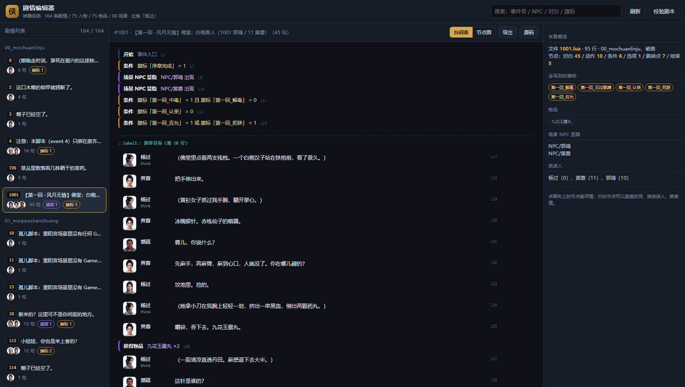
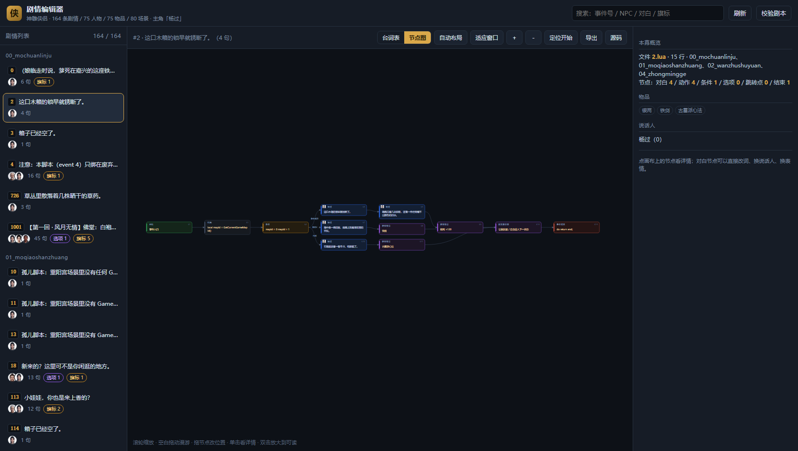

# 神雕侠侣 · Web 剧情编辑器

把 `jyx2/Assets/Mods/shendiao/Lua/*.lua` 里的剧情**画成节点图**，并且在浏览器里直接改台词、
换说话人、换表情，写完立刻做语法自检。目标是让「这段戏谁说的、引发了什么影响」一眼看清，
不用在 100 多行 Lua 和 Excel 之间来回翻。



## 一分钟上手

### 方式一：本机直接跑（不用装任何 pip 包）

```powershell
python tools/storyeditor/serve.py
# 浏览器打开 http://127.0.0.1:8777
```

只用 Python 标准库（`http.server`），Python 3.8+ 即可；前端是原生 JS + SVG，**零 npm / 零构建**。

### 方式二：Docker（推荐，环境隔离）

```powershell
cd tools/storyeditor
docker compose up -d --build
# 打开 http://127.0.0.1:8777 ；停掉用 docker compose down
```

compose 把**仓库根挂到容器的 `/repo`**，所以编辑器改的就是仓库里的真文件：

```
../..            ->  /repo
/repo/jyx2/Assets/Mods/shendiao/Lua/*.lua      剧本
/repo/jyx2/Assets/Mods/shendiao/Configs/Lua    人物 / 物品 / 武功 / 战斗 / 场景
/repo/jyx2/Assets/Mods/shendiao/BuildSource/head/*.png   头像（含 9000000 表情虚拟 id）
```

换 MOD：`docker compose run --rm storyeditor python /app/storyeditor/serve.py --mod /repo/jyx2/Assets/Mods/JYX2`，
或本机 `python tools/storyeditor/serve.py --mod jyx2/Assets/Mods/JYX2`。

## 界面怎么看

两种视图，工具栏切换（默认「台词表」，选择记在浏览器里）：

**① 台词表** —— 按源码行号顺序的对话流，用来**读和改**：头像 + 说话人 + 表情小字 + 台词 + 行号；
夹在中间的是 `条件 / 玩家选项 / 场景NPC 显隐 / 获得物品 / 事件结束` 这些小条，`::label1::` 当分隔线。
点任意一行，右栏就是它的编辑面板。

**② 节点图** —— 控制流，用来**看结构**：条件分支、goto 跳转、汇合点一眼看清。



| 区域 | 内容 |
| --- | --- |
| 左栏 | 164 条剧情，按场景分组；每行是 `事件号 + 标题 + 说话人头像 + 句数 + 选项/旗标/战斗数`。顶部搜索框对 **事件号 / 标题 / NPC 名 / 台词全文 / 旗标名** 做过滤 |
| 中间 | 台词表或节点图。节点图里：滚轮缩放、空白拖动漫游、拖节点改位置（浏览器 localStorage 按事件号记）、单击看详情、**双击放大到可读**；工具栏有自动布局 / 适应窗口 / 定位开始 |
| 右栏 | 选中项的详情。**对白**可以改说话人、表情、台词，`Ctrl+Enter` 保存；其它节点只读，但参数会翻成人话 |

节点颜色：绿=开始、蓝=对白、紫=玩家选项、琥珀=条件、紫红=动作（旗标/物品/战斗/镜头…）、
青=跳转 label、红=事件结束、灰=其它代码。边上的「条件成立 / 否则 / 是 / 否」就是分支。

右栏没选项时显示**本幕概览**：会写到哪些旗标、拿什么物品、打哪场战斗、显隐哪些场景 NPC，
以及解析告警（比如 `goto` 找不到 label）。URL 也能直达：`#1001` / `#1001/graph`。

## 它能改什么，不能改什么

**能改（安全，行级回写）**

- 一句台词的文本、说话人人物 Id、表情（`EXPR.x`）
- `ShowMessage` 旁白文本
- 整份源码（「源码」按钮，保存前做块配平体检）

**暂时不能改**（下一版）：插入 / 删除节点、改分支条件、改动作参数（物品 Id、战斗 Id、旗标值）、
拖动改连线。这些要动结构，得先把「节点 ↔ 行区间」的映射升级成可插入的。

## 回写的安全设计

1. **只替换目标行**：保留原缩进、结尾分号、行尾 `-- 注释`、行尾是 CRLF 还是 LF
   （13 个脚本是 CRLF，这一条踩过坑：`newline=''` 忘了就整份变 LF）。
2. **乐观锁**：前端把「当前行的原文」一起发过来，服务端对不上就 `409`，不盲写。
3. **改前备份**：`tools/storyeditor/.backups/<事件号>.<时间戳>.lua`（已 gitignore，留最近 200 份）。
4. **改后自检**：立刻重跑解析 + `tools/shendiao/lint_lua.py` 的规则，把问题回给界面。
   整份源码保存时，块配平不过直接拒绝落盘。
5. 人物 Id / 表情名不在表里直接拒绝 —— `Talk(99, ...)` 会让 `ChatUIPanel` 空引用，
   进而把整张图的交互点锁死（见 `docs/jyx2-mod-guide.md` §5.2）。

## 重要：改完还是要重打 AB

Lua 剧本在 `<id>_mod` 这个 AssetBundle 里，**编辑器只改源文件**，游戏里要生效仍然要走：

```powershell
python tools/moddev/jyx2mod.py unity shendiao      # 重打 AB（改了 Lua 也要重打）
python tools/moddev/jyx2mod.py install shendiao --src Export/shendiao
```

编辑器里的「校验剧本」按钮等价于：

```powershell
python tools/shendiao/lint_lua.py
python tools/shendiao/check_story.py
```

## 代码结构

```
tools/storyeditor/
  serve.py            HTTP 服务 + REST 路由（标准库，无依赖）
  story_mod.py        MOD 只读数据层：配置表 / 场景事件索引 / 头像 / 名字解析
  story_lua.py        Lua 剧本 -> 节点图（语句树 + 分段 + 分支边），带行号与原文
  story_edit.py       行级回写、备份、语法自检、（可选）调用 lint/check_story
  survey_lua.py       统计剧本用到的 Lua 构造，判断解析器覆盖面
  selftest_story.py   自测：解析全部剧本 + 回写保真 + 护栏
  static/             前端：index.html / style.css / graph.js / app.js
  Dockerfile / docker-compose.yml
```

### 自测（改了解析或回写逻辑必跑）

```powershell
python tools/storyeditor/selftest_story.py
```

它做三件事：

1. 解析全部剧本，要求「边不悬空、Talk 数与源码一致、没有 goto 找不到 label」；
2. 在一份**临时拷贝**的 MOD 上改一行再改回来，要求「只有那一行变、CRLF 保留、还原后逐字节一致」；
3. 护栏：原文对不上 / 人物 Id 不在表里 / 语法坏掉，都必须拒绝写入且不动文件。

### REST 一览

| 方法 | 路径 | 作用 |
| --- | --- | --- |
| GET | `/api/meta` | MOD 名、主角名、人物表、表情表、场景表、统计 |
| GET | `/api/events` | 全部剧情摘要（列表 + 搜索用） |
| GET | `/api/event/<id>?source=1` | 单个事件的节点图（`nodes` / `edges` / `segments` / `stats` / `source`） |
| GET | `/api/head/<id>.png` | 头像（`9000000+角色*10+槽位` 的表情虚拟 id 也支持） |
| POST | `/api/refresh` | 重读配置表 / 场景索引（改完 xlsx 后点） |
| POST | `/api/event/<id>/line` | 改一句对白：`{line, expect, kind, role, expr, text}` |
| POST | `/api/event/<id>/source` | 整份保存源码：`{text, mtime}` |
| POST | `/api/validate` | 跑 `lint_lua.py` + `check_story.py` |

## 解析器的边界（什么时候要改它）

`story_lua.py` 不是完整的 Lua 解析器，只覆盖剧本的既有写法（`survey_lua.py` 的统计）：

| 构造 | 现有剧本 | 解析器 |
| --- | --- | --- |
| `Talk` / `ShowMessage` / 各种动作调用 | 全部 | ✅ 识别，动作翻成「物品 XX ×2」这类人话 |
| `if ... then goto L end;` | 29 个文件 | ✅ 变成「条件」节点 + 条件成立/否则两条边 |
| `if ... then ... elseif ... else ... end` | 3 个文件，最深 4 层 | ✅ 每个分支各自成链，最后汇合 |
| `::label::` / `goto label` | 29 / 4 个文件 | ✅ label 变成跳转节点，goto 连成虚线边 |
| `do return end` / `return` | 164 个文件 | ✅ 变成「事件结束」节点 |
| `ShowYesOrNoSelectPanel` | 3 个文件 | ✅ 变成「玩家选项」节点（是 / 否） |
| `local x = ...` / 赋值 / 不认识的调用 | 5 个文件 | ✅ 当「代码」节点，只读展示 |
| `while` / `for` / 函数定义 | **0 个剧情脚本** | ⚠️ 会当代码节点吞掉，不展开循环体 |

**结论**：剧本里开始出现 `while` / `for` / 局部函数时，先跑 `survey_lua.py`，
再决定要不要给解析器加循环展开。

## 后续路线（按用户原话：先对话，再法术 / 物品 / 地图）

1. **对话编辑增强**：插入 / 删除对白、拖动排序、条件编辑（旗标 + 比较 + 值）、
   动作参数编辑（物品 / 战斗 / 武功下拉）、同一事件内「台词表」视图（比图更适合批量改词）。
2. **法术 / 武功表编辑**：直接读写 `Configs/武功.xlsx`，注意必须用 xlsxwriter 重写
   （老版 ExcelDataReader 只认 sharedStrings，见 `docs/jyx2-mod-guide.md` §3.4）。
3. **物品表编辑**：同上看 `物品.xlsx`。
4. **场景编辑**：把 `Maps/GameMaps/*.unity` 的 `Level/Triggers/*` 事件、NPC 位置读成 2D 俯视图，
   点击 NPC 直接跳到它的对话 —— 这需要复用 `tools/shendiao/inspect_events.py` 的思路。
5. **发布闭环**：编辑器里一键 `jyx2mod.py unity` + `install`（Docker 内调 unity 不现实，
   更适合做成「生成命令 → 本机执行」）。

## 已知限制

- 节点位置只存在浏览器本地（localStorage），换机器要重摆；想跨机器共享可以把 `pos` 存成 `tools/storyeditor/layout/<事件号>.json`（下一步）。
- 图里显示的是**控制流**，不是「玩家实际看到的一句一句」：一个 `if` 节点的两条边都画出来了，
  阅读顺序要顺着边看。
- 头像请求走 `/api/head/<id>.png`，第一次打开大事件会拉几十张 512×512 PNG（本机很快，局域网会慢一点）。
- 只读 `Lua/*.lua`；`ModSetting.asset` 的 `LuaFilePatten` 不是 `{0}` 的 MOD（比如内置 `JYX2` 用 `ka{0}`）也能用，
  但事件号与文件名不再一致，左侧列表会直接按文件名列出。

